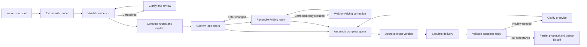

# Air freight RFP AI V2 design specification

## Decision

Build a parallel **AI Lab** with LangGraph.js and the current Next.js and TypeScript stack. A reviewer opens the same imported RFP and starts an isolated V2 run. The lab shows evidence-backed suggestions, a route comparison, and a rehearsal of quote approval through simulated kickoff. V1 stays the comparison baseline. The first slice ends after reviewed routing.

Use the model to interpret requests, suggest clarifications, and explain tradeoffs. Route feasibility, rate validation, quote versioning, acceptance, and writes use the existing rules. This gives V2 an AI-led reviewer experience with independently verifiable outcomes. An optional later experiment can let the model propose routes from a bounded set of real legs and compare its proposals to the exact engine.

## How the RFP workflow maps to LangGraph

| Step | Node and inputs | Output or next action |
|---|---|---|
| Start | Load the imported workbook, notes, optional email, and flight snapshot by RFP ID. | Create a run against an immutable input revision. |
| Extract requirements | Ask the model for typed lane claims with source ID, verbatim span, and service label. Run the existing evidence validator and flag conflicts or missing details. | Route confirmed requirements. Ask the reviewer to resolve unclear ones and offer a draft clarification. |
| Assess routes | Run the existing graph search using the saved transit snapshot. Ask AI for a short explanation using only the returned assessment and leg IDs. | Show feasible routes, gaps, and the evidence behind them. Require the reviewer to confirm what to offer. |
| Price confirmed offers | Capture the current offer scope. Read a simulated reply through structured extraction and run the rate matcher. | Valid rates attach to the scoped request. Missing, qualified, conflicting, and out-of-scope rates create issues. Pricing can advance while other lane decisions remain open. |
| Draft and approve | Render exact terms from validated rates and decisions. Use the model for editable surrounding prose. | Pause until a reviewer approves the precise version. A stale revision sends the run back to the relevant stage. |
| Deliver and close | Run the simulated email adapter. On reply, suggest an intent and cite the text. Server rules check sender, thread, version, and explicit full acceptance. | Ambiguous or conditional replies pause for review. Verified acceptance writes the proposal and queues kickoff through the existing transaction and outbox pattern. |



The diagram shows data dependencies. The quote node runs only when all lanes have a decision and every offered lane has a current validated rate. The Pricing node can operate on an earlier subset. A clarification that leaves terms unchanged can wait for another reply on the existing quote.

Use LangGraph.js `StateGraph` for typed nodes and explicit transitions. Use `interrupt()` and `Command({ resume: ... })` for reviewer decisions. Store IDs and revision references in checkpoint state, alongside small typed node outputs. Structured resume inputs must pass authorization and revision checks. Put writes in separate replay-safe nodes or transactional operations, since interrupted nodes can re-execute when resumed. Emit node start, outcome and source references to the activity panel. [LangGraph interrupts](https://docs.langchain.com/oss/javascript/langgraph/interrupts) · [LangGraph persistence](https://docs.langchain.com/oss/javascript/langgraph/persistence)

## Model integration and developer workflow

- **Fixture provider.** A V2 provider returns typed outputs for the existing sample and an evaluation corpus. Add cases for unmatched passages, unsupported services, omitted rates, malformed output and timeouts. Run the same nodes, validation and review gates as live mode. Display the active mode in each trace.
- **Live provider.** Reuse the server-side structured Responses API adapter in [src/ai/structured.ts](../src/ai/structured.ts) with scoped settings such as `RFP_V2_MODEL_MODE=openai` and `RFP_V2_OPENAI_MODEL`, using the existing server-only `OPENAI_API_KEY`. Keep fixture mode the default. Apply per-node timeouts and input budgets, log model and prompt version, and surface exhausted retries for review. Start with one prompt and schema per task. LangChain model wrappers can be introduced if provider portability becomes a requirement.
- **Dev kit.** Ship a local run/replay command, a few named scenarios, and an event trace in the lab. Use LangSmith Studio optionally to inspect graph steps on synthetic inputs when an Agent Server dev setup is useful. Use the repo's existing tests as regression coverage and add a small expected-output corpus for model evaluation. [LangGraph TypeScript workflow example](https://docs.langchain.com/oss/javascript/langgraph/thinking-in-langgraph) · [LangSmith local development](https://docs.langchain.com/langsmith/local-dev-testing)
- **Persistence.** Persist the serialized LangGraph checkpoint and pending writes in the separate lab run table on SQLite or Turso. Reload them before each review and use a revision check to publish the result only once. The adapter uses a versioned payload tied to the installed LangGraph checkpoint format, so rerun restart and concurrent-review tests when upgrading LangGraph.
- **Isolation.** Share read-only inputs and pure domain functions. Give V2 its own run IDs and store its proposal records, simulated mail and outbox in a separate database. The comparison screen uses the same immutable input snapshot for both versions. Deduplicate effects by run, action and input version. Use a run ID plus revision to reject stale resumes and repeated clicks.

## Interactive route explorer

Show the extraction, review and comparison stages horizontally. Display multiple lanes as rows, with competing itineraries side by side on wider screens. Direction, transit time and missing services appear on each leg. Expanding a leg reveals its inventory row and available services.

| Visual | Meaning |
|---|---|
| Green solid leg marker | The leg satisfies the lane's service requirements. |
| Amber dashed edge with a gap label | The leg has a service gap. The route can be offered only if policy permits it and a reviewer confirms the disclosure. |
| Red itinerary label | A hard constraint blocks the itinerary. Show the transit cap on the lane and an explicit no-path label for unreachable lanes. |

Show counts across the whole RFP, with filters and paged lane rows. A read-only route assistant can summarize outcomes, apply a filter or focus a directed lane. Fixture mode uses deterministic query rules. Configured OpenAI mode can interpret unfamiliar phrasing into the same bounded query types. Answers use the assessed data from the current run. Label workbook-backed data as **Inventory snapshot**. Live flight positions, schedules or disruptions would require a separate data source and a freshness indicator.

After the schematic, add a geographic view if spatial context is useful. Join IATA codes to a vetted airport-coordinate dataset and use deck.gl `ArcLayer` for selectable flight arcs. Missing coordinates should leave the leg available in the schematic and table. The geographic arc expresses connectivity, while the assessment displays workbook transit time. [deck.gl ArcLayer](https://deck.gl/docs/api-reference/layers/arc-layer)

## Implementation phases and acceptance checks

1. **Local vertical slice.** Import the same sample, start V2 in fixture mode, extract requirements, pause for review, run the existing routing engine, and open the route explorer. Add one live extraction call as an opt-in. Recover to manual review on timeout or invalid output.
2. **Comparison and checkpoints.** Add V1 and V2 comparison for evidence, corrections, route outcomes and time to review. Persist checkpoint state across process restarts before hosted evaluation. Reject stale resumes and test that V2 runs cannot mutate V1 proposal state.
3. **Workflow parity.** Add scoped Pricing, quote approval, simulated sends, reply triage, and idempotent kickoff. Compare exact terms against V1 for equivalent reviewed inputs.
4. **Pilot evaluation.** Test on de-identified examples. Measure lane-to-service accuracy, missed mandatory requirements, reviewer correction rate, time to reviewed offer, latency and model cost. Track invalid accepted rates, false acceptance and duplicate actions as failure counts. Promote live mode after the workflow is auditable and the model shows a measurable improvement.

The minimum demo covers MEX → CDG choosing the compliant 11-day direct route, GRU → SIN comparing the 4-day service gap to the 11-day full-service alternative against an 8-day cap, and FAI → SIN showing disconnected inventory. Add an ambiguous source passage that pauses for review. Beyond the first slice, also demonstrate a wrong-scope rate and retry a simulated kickoff without creating a duplicate.

## Run the local lab

The lab implements requirement extraction, a reviewer checkpoint, route comparison, and an isolated commercial proposal workflow. Start the server in fixture mode.

```sh
npm run dev
```

Load a sample RFP from the home page, click **AI Lab** in the top-right header, and select the same RFP. Select **Add a simulated ambiguous instruction** and run extraction. Review the excerpt. For example, resolve it as a clarification that the simulated instruction adds no requirements. If it changes a lane, open that lane, adjust its services, and confirm the selection. Save a review note and continue to compare routes. The graph pauses and resumes on the same saved run. Use **Open a recent run** or reopen its URL within one hour after a restart. Use **Compare V1 and V2** to see extraction evidence, reviewed services, routing outcomes, and elapsed review times. Analyze the RFP in the original workflow to populate the V1 baseline.

V1 stays available under `/rfps/[id]` and the lab is available under `/lab/[id]`. Set `RFP_V2_ENABLED=0` to hide the lab on a local server. Vercel previews require an explicit `RFP_V2_ENABLED=1`. Lab checkpoints use the configured Turso connection there. Hosted verification and model-generated route explanations remain separate from the local workflow.

For live extraction, configure `RFP_V2_MODEL_MODE=openai`, `RFP_V2_OPENAI_MODEL` and the server-side `OPENAI_API_KEY`, then start a new lab run.

## Run the V2 proposal

After confirming requirements and comparing routes, click **Open lab proposal**. The lab copies the already-reviewed workbook snapshot into an isolated commercial workspace. Confirm lane offers, simulate Pricing replies and reconcile any issues. Generate a quote, approve its exact version and send it to the simulated inbox. Try partial acceptance, then test full acceptance with a temporary calendar failure. Retry kickoff scheduling or replay the acceptance to see its existing record.

Use **Compare V1 and V2** after both versions have a saved quote. The comparison checks the commercial terms by directed lane and resolves copied flight IDs to original inventory rows. Compare proposals made with the same offered services and rates. The saved proposal URL continues working after the one-hour analysis window.

Local commercial records use the SQLite file alongside the original file with a `.lab.sqlite` suffix. Hosted proposals require a separate Turso database configured with `RFP_V2_DATABASE_URL` and `RFP_V2_DATABASE_AUTH_TOKEN`. The lab never falls back to the V1 database for commercial writes. Simulated send and kickoff jobs can be processed or retried in the lab UI.

## Reuse in this repository

- [Workbook import](../src/intake/import-rfp.ts) and [source validation](../src/routing/extraction.ts)
- [Route search](../src/routing/engine.ts) and [offer policies](../src/routing/contracts.ts)
- [Pricing reconciliation](../src/pricing/rates.ts), [quote versioning](../src/quotes/quote.ts), and [acceptance transaction](../src/closeout/proposals.ts)
- [Outbox and retries](../src/workflow/outbox.ts) and the [sample browser walkthrough](../tests/e2e/exercise.spec.ts)
