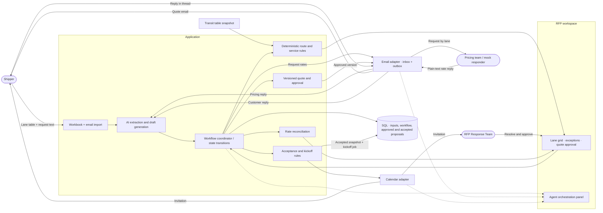

# Air freight RFP automation
## Design specification

The carrier’s RFP Response Team uses one workspace to turn a shipper’s lane table and email into a reviewed proposal. Each lane ends with a priced offer, a disclosed exception, or an explicit no-offer outcome. A clear customer acceptance records the approved proposal in SQL and triggers a kickoff invitation.

[Phased implementation plan](implementation-plan.md) · [Open the component map](component-map.html) · [Open the interactive walkthrough](../demo/index.html) · [Source workbook](../Air_Freight_RFP_Mock_Data.xlsx)

## 1. Component diagram

Solid arrows show the paths that move the RFP and its supporting records through the system. Dotted arrows feed the activity panel.

### Responsibility by component

| Component | Responsibility and record produced |
|---|---|
| Intake | Import XLSX lane and transit sheets and optional separate plain-text shipper email. Validate headers, airport codes, unique directed lane keys, positive tonnage and leg durations, and valid lane transit limits. Preserve raw text, workbook row references and a transit data snapshot. |
| AI extraction and drafting | Link text to known lanes and emit candidate requirements with evidence and unresolved items. Parse Pricing replies into candidate rates and customer replies into candidate intent. Draft email prose from selected records. |
| Routing | Read the directed flight graph. Check reachability, summed leg duration, and service coverage across every selected leg. Return an explainable decision with flight row IDs, per-leg services, unmet requirements and any alternative. |
| Workflow and rate reconciliation | Apply rules and reviewer decisions, match prices to requested lanes and scope, guard approval and acceptance, and maintain state across email and calendar calls. Validate model output before applying it. |
| Reviewer workspace | Show all lanes, evidence, route details, exceptions, requested and offered services, rate coverage, draft and approval. Give each blocked item a next action and an owner. |
| Agent orchestration panel | Show named actions with time, status, input or record links, result, and next action. Display routing evidence, service gaps, pricing mismatches, approvals, acceptance and retry outcomes. |
| Email and calendar adapters | Use the same lifecycle for simulated and live integrations. Track message and thread IDs, quote version, calendar job status and provider event ID. |
| SQL | Preserve the inputs, working decisions, approved quote versions, accepted proposal snapshot, outbound jobs, and activity history. |

## 2. Workflow and human decisions

| Stage | Application behavior | Human decision or exit condition |
|---|---|---|
| Import the RFP | Read each origin, destination, freight tonnage and maximum days. Attach row-level email text or map one email across lanes. Normalize known service terms and retain the source excerpt. | Resolve ambiguous lane references, conflicting statements, unknown services, and invalid data before routing affected lanes. |
| Find eligible routes | Run the shortest-path search on directed legs that offer all confirmed services. Accept a result within the time cap, with ties broken by fewer legs and then stable airport and leg IDs. | Review cases with no fully compliant route. An eligible alternative with a service gap can be offered only after explicit review, with the gap visible in the proposal. A no-offer lane stays visible in the quote. |
| Ask Pricing | Email all currently confirmed offers with tonnage, requested and offered services, route, transit time, and a request reference. Other lanes can remain in review. The mock responder returns a free-text email with per-lane rates. | Resolve missing, duplicate, ambiguous, conflicting, or out-of-scope rates. A route, tonnage or offered-service change requires a fresh rate or Pricing reconfirmation tied to the new scope. |
| Prepare and send | Build the lane table from validated records and let AI draft the surrounding prose. Include route sequence, time, fulfilled and unfulfilled services, currency and price per ton. Mark declined lanes explicitly. Freeze the approved version and queue email for delivery. | Confirm every lane disposition and validate all offered rates before approving the exact customer email. Require a new approval for changes to an approved draft. |
| Process the response | Match an inbound reply to the customer thread and active sent version. Record clear full acceptance and its evidence. Route counteroffers, partial acceptances, ambiguous references and superseded versions to review. | Resolve the exception and issue a revised quote when needed. |
| Record and schedule | In one SQL transaction, store the accepted quote and lane snapshot and queue kickoff work. Resolve invite attendees, time and timezone, then book via the calendar adapter. Show scheduling status and retry recoverable failures. | Confirm missing attendee or scheduling information, or handle an exhausted retry. Acceptance remains recorded while scheduling is pending. |

### Routing rules for the prototype

- Use the sum of leg durations and treat the cap as inclusive. The workbook provides leg-level service flags. Live use needs connection times, transfer handling, capacity and the carrier’s operational approval rules.
- A service counts as fulfilled only when every leg supports it. When full compliance fails, search for a time-feasible path and rank alternatives by most requested services fulfilled end to end, then fewest days, fewest legs and stable IDs. With the workbook’s small service vocabulary, the search can track the intersection of services supported along each path.
- Classify each lane as fully compliant, time-feasible with a service gap, over the time limit, or unreachable. Surface the best relevant evidence and keep any AI-extracted ambiguities in review.
- Service exclusions that need operational approval, especially safety-critical or mandatory services, remain blocked until the applicable policy and the shipper’s requirements permit an exception. The prototype illustrates a reviewed fragile-handling exclusion.

## 3. Data and reliability

| SQL records | What they store |
|---|---|
| **RFP, source attachment, lane, transit snapshot, flight leg** | Customer/thread identity, source references, raw text, airport pairs, tonnage and transit time values, leg capabilities and exact import revision. |
| **Requirement, route decision, review task** | Normalized requirement and evidence, selected legs, total days, supported/missing services, reviewer disposition, reviewer and timestamp. |
| **Pricing request, rate, message** | Request ID, lane and versioned scope, decimal amount, currency, per-ton basis, original reply and reconciliation result. Store provider message IDs for deduplication. |
| **Quote version, quote lane, approval** | Immutable customer-facing terms, each included lane’s route, services, rate or no-offer reason, approver, send state and provider thread. |
| **Accepted proposal, accepted lane, kickoff job, activity event** | Accepted quote/version and reply evidence, snapshot of the accepted terms and lane dispositions, invite state/provider ID, and an audit trail. |

A transactional outbox queues quote sends and kickoff work with a unique key for each quote version and action. Workers reuse provider idempotency where available and reconcile ambiguous results against provider records before retrying. Replaying an inbound reply must yield one accepted proposal and one kickoff job for that quote version. Team permissions govern who can approve and send. Treat inbound text as data, keep tenant data scoped to the relevant RFP, and let application rules authorize sends and writes.

## 4. Demo and acceptance checks

These three lanes come from the source workbook. The rates, replies, and kickoff time in the walkthrough are fixtures.

| Case | Expected evidence and decision |
|---|---|
| **MEX → CDG · 12.3 tons · 11-day limit** | MEX → LHR → CDG takes 10 days and lacks dangerous-goods handling on MEX → LHR. The direct 11-day flight supports it and is selected. Shipper row 3, transit rows 22, 46 and 69. |
| **GRU → SIN · 19.1 tons · 8-day limit** | The direct route takes 4 days and has no fragile handling. The fastest fragile-capable route takes 11 days. The reviewer can disclose the gap and request a rate for standard handling, or decline. Shipper row 5, transit row 71 for the direct leg and rows 44, 58 and 89 for the fragile-capable route via DXB and MIA. |
| **FAI → SIN · 46.1 tons · 20-day limit** | FAI and ANC only connect to each other in the workbook. Confirm a no-offer disposition. Shipper row 2, transit rows 100 and 101. |
| **Pricing exception** | When an offered lane is missing from the reply, approval remains blocked. A complete reply clears the pricing exception. |
| **Approval and delivery** | Every lane appears in the quote. Selecting the fragile-handling alternative shows its exclusion and a matching rate. Sending becomes available after explicit approval. |
| **Acceptance and kickoff** | A partial reply requires review. Full acceptance records one proposal and queues one kickoff. A simulated failure leaves the kickoff retryable. Replaying acceptance preserves the one proposal and one invite. |

## 5. Delivery slices and open decisions

1. **Workbook to reviewed lanes.** Build import, extraction, routing, evidence and exception review. Validate against the workbook and confirm that multi-lane emails map to the right lanes.
2. **Reviewed lanes to sent quote.** Add the Pricing mock, reconciliation, draft approval, email adapters and workflow activity. Exercise missing and stale rates before connecting a real inbox.
3. **Sent quote to kickoff.** Add inbound reply handling, accepted records in SQL, reliable scheduling, and end-to-end tests with simulated providers. Add live provider adapters after the client confirms systems and ownership.

Confirm with the client which service gaps may be offered, the currency and meaning of “ton,” how flight and transfer capabilities are validated, who can approve a proposal, and who sets kickoff attendees, timezone, and timing. The walkthrough assumes USD per ton, summed leg durations, manual approval before sending, and a preset kickoff slot. Its email, SQL and calendar views show simulated records held in browser memory.
